<div align="center">
  

  <br/>

  <a href="https://github.com/shenyicong">
    
  </a>
  <a href="https://github.com/shenyicong?tab=followers">
    
  </a>
  
  
</div>


```console
shenyicong@github:~$ whoami
→  学生开发者 / 从寄存器到浏览器

shenyicong@github:~$ cat focus.txt
→  单片机:   AT89C51 · 传感器驱动 · 电机控制 · 状态机
→  数据:     Python 采集 · 清洗 · 统计 · 可视化
→  Web:      HTML / CSS / JS · 交互与业务逻辑

shenyicong@github:~$ echo $PHILOSOPHY
→  "能跑起来只是及格，能解释清楚才算学会。"
```


## ⚡ 技术栈

<div align="center">

**— 嵌入式 / Embedded —**


<!-- 传感器 / 外设 -->


**— 数据 / Data —**


**— Web / 工具 —**


</div>


## 🧩 精选项目

<table>
<tr>
<td width="50%" valign="top">

### 🌡️ 智能风扇系统
> *AT89C51 · C · Proteus*

温度闭环控制的完整嵌入式系统。DS18B20 采集 → 单片机运算 → L298 驱动电机调速，LCD12864 实时显示。

**技术要点**
- 单总线时序驱动（`Qnewire.c` 手写位操作）
- 五键交互状态机：START / STOP / `+` / `-` / MODE
- 显示与采集分离的模块化架构

`main.c` `LCD12864.c` `DS18B20.c`

[→ 查看仓库](https://github.com/shenyicong/smart-fan-at89c51)

</td>
<td width="50%" valign="top">

### 📊 车型数据可视化分析
> *Python · 爬虫 · 数据清洗*

面向易车网的车型数据采集与多维分析管线。

**技术要点**
- 分层清洗：缺失值 / 异常值 / 重复值识别与处理
- 数值 + 分类特征分别处理策略
- 可视化驱动的结论输出

`requests` `pandas` `matplotlib`

[→ 查看仓库](https://github.com/shenyicong/yiche-car-analysis)

</td>
</tr>
<tr>
<td width="50%" valign="top">

### 🍜 外卖管理系统
> *HTML · CSS · JavaScript*

纯前端实现的完整业务闭环，订单流转全程可视化。

**技术要点**
- 商品 → 购物车 → 下单 → 订单状态的链路设计
- 原生 JS 状态管理，无框架依赖
- 响应式布局

`vanilla JS`

</td>
<td width="50%" valign="top">

### 🚀 星骸战甲 ASTRA FRAME
> *Three.js · WebGL · 原生 JS*

浏览器端第三人称科幻射击演示。程序化生成战场与贴图，逐步揭开地图迷雾。

**技术要点**
- 全程序化贴图：分形噪声 → 高度图 → 法线贴图，零外部资源
- 迷雾视野系统：标量场 + 着色器遮罩，未探索区域不渲染敌人
- 性能优化：固定步长逻辑、实例化网格、对象池、动态像素比

`Three.js` `ShaderMaterial` `WebAudio`

[→ 查看仓库](https://github.com/shenyicong/astra-frame)

</td>
</tr>
</table>


## 📈 活跃度

<div align="center">


<br/>


<br/>


</div>


## 🎯 当前动态

```yaml
正在学习:
  - 嵌入式系统设计模式与可维护性
  - Python 数据管道的工程化
  - Git 工作流与协作规范

正在构建:
  - 星骸战甲 ASTRA FRAME（Web 端实时射击）
  - 智能风扇系统的代码重构
  - 车型数据分析的可复现流程

开放合作:
  - 嵌入式 / 数据方向的实习与项目合作
```


<div align="center">

**「把复杂问题拆到能讲清楚为止。」**

<br/>


<sub>最后更新 · 2026</sub>

</div>
